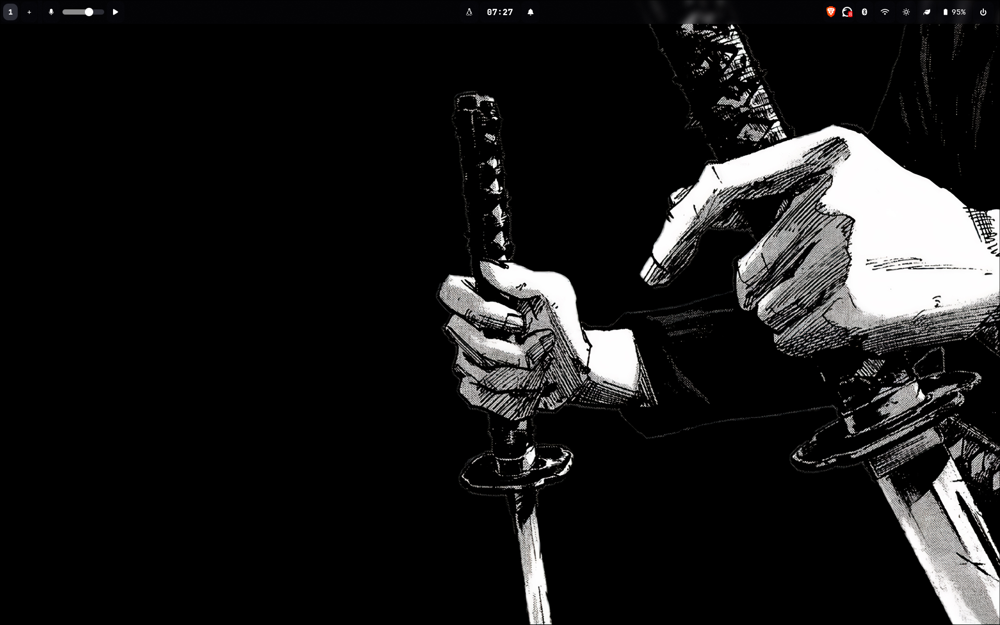
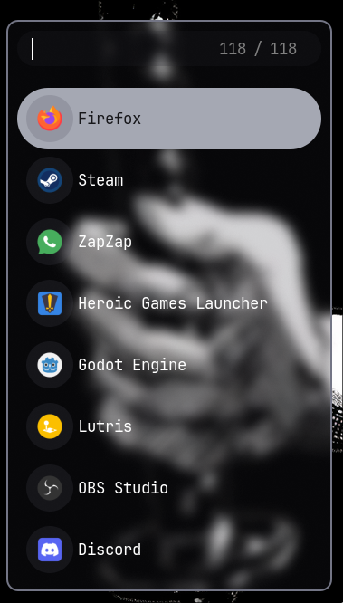
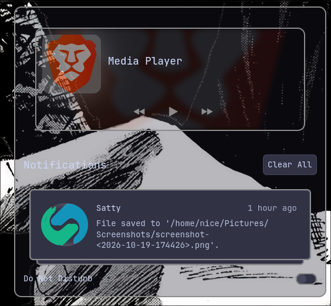
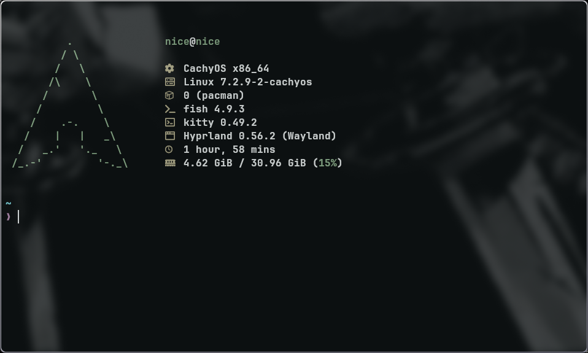
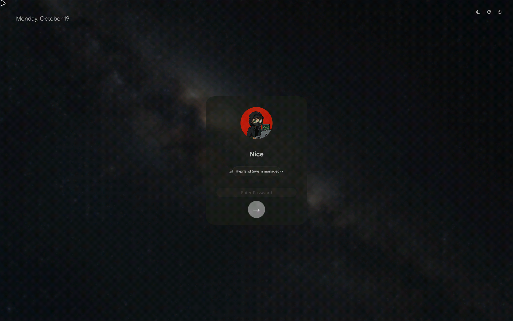
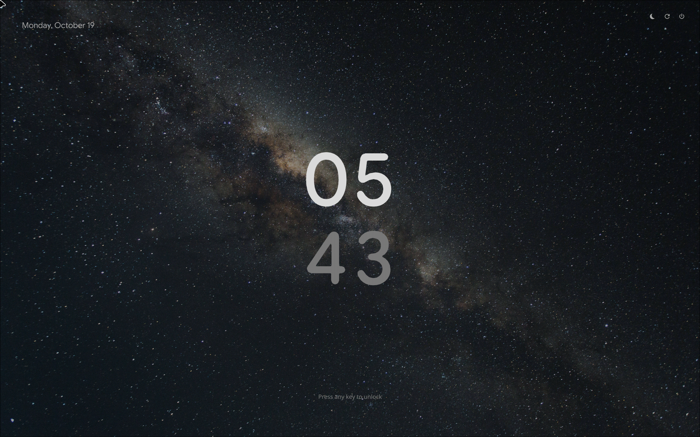

<div align="center">

# Minimalism Shell

**A minimal, modular desktop environment built on Hyprland.**

[](https://hyprland.org)
[](https://cachyos.org)
[](LICENSE)
[]()

*Greyscale visual identity · TypeScript/AGS coming soon*

**Languages: 🇬🇧 English · [🇪🇸 Español](README.es.md)**

</div>

---

## ✨ Features

- **Compositor:** Hyprland (Lua config, `hl.*` API).
- **Bar:** Waybar with the canonical greyscale palette (`palette.css`).
- **Launcher:** Rofi (drun) in greys.
- **Terminal:** Kitty with a desaturated theme and easy copy/paste (select = copy, middle-click = paste).
- **Notifications:** SwayNC recoloured to greys (red only for alerts).
- **Screenshots:** `hyprshot` + `satty` through a single `screenshot` command (Super+P / Print).
- **Wallpapers:** `waypaper` (Super+Shift+W), restored automatically at login.
- **Image viewer:** `imv` (lightweight, Wayland-native).
- **Login:** SDDM with a greyscale Pixie theme and its own background.
- **Lock screen:** `hyprlock` (clock + blur) with `hypridle` (dim → lock → DPMS off → suspend).
- **Multi-monitor** with an automatic *fallback* rule.
- **Auto-detected GPU:** NVIDIA / AMD / Intel — the video backend is only applied when that GPU is present (portable across machines).

> **Current phase — Baseline 1.0:** the static environment stabilised and packaged as
> dotfiles. The dynamic TypeScript modules (Topbar, Launcher, Control Center) with
> AGS/Astal + GTK4 come in a later phase.

## 🖼️ Screenshots

Samples captured on the reference machine (laptop panel, 1920×1200@165):

<p align="center">
  
</p>

<p align="center">
  
</p>

<p align="center">
  
  
</p>

<p align="center">
  
</p>

<p align="center">
  
  
</p>

## 💾 RAM usage

The whole shell (compositor + bar), idle with no apps open: **~170 MB**.
Very light: on an 8 GB base it leaves ~7.8 GB free. Each app you open adds its own RAM.

## ⌨️ Keybindings

| Shortcut | Action |
|---|---|
| `Super + T` / `Super + Q` | Terminal (kitty) / close window |
| `Super + A` / `Super + E` | Launcher (rofi) / file manager (thunar) |
| `Super + W` / `Super + F` | Toggle float / toggle fullscreen |
| `Super + L` / `Super + M` | Lock (hyprlock) / log out |
| `Super + P` / `Print` | Screenshot region / full screen (via satty) |
| `Super + 1…0` | Go to workspace 1–10 |
| `Super + Shift + 1…0` | Move window to workspace 1–10 |
| `Super + S` | Toggle scratchpad (special workspace) |
| `Super + Shift + W` | Wallpaper manager (waypaper) |
| `Super + ←↑↓→` / `Alt + Tab` | Focus window / next window |
| `Ctrl + Shift + F1…F4` | Volume − / + / mute / mic mute |
| `Ctrl + Shift + F5…F8` | Media: prev / play-pause / next |
| `Super + B / G / C / Y / H` | Brave / Firefox / VSCodium / Spotify / Heroic *(optional apps — install your own)* |

Full reference (relative workspaces, silent moves, mouse, waybar clicks…):
[docs/KEYBINDINGS.md](docs/KEYBINDINGS.md) · [español](docs/KEYBINDINGS.es.md)

## 📦 Installation

**Requirements:** CachyOS/Arch (or any Arch derivative) with **Hyprland** installed.

```bash
git clone https://github.com/ImGabo1/Minimalism-Shell.git ~/minimalism-shell
cd ~/minimalism-shell
./install.sh          # interactive menu
```

Running it in a terminal shows the menu (install everything, dotfiles only,
packages only, SDDM only, GPU info, or preview the package list). Flags keep
working for scripting (`./install.sh` with no TTY installs everything):

```bash
./install.sh --menu     # force the interactive menu
./install.sh --dotfiles # only symlinks for ~/.config (+ prior backup)
./install.sh --packages # only the packages
./install.sh --sddm     # only deploy the SDDM theme
./install.sh --gpu      # only show the detected GPU
./install.sh --list     # preview which packages would be installed
```

- Existing configs are **backed up** to `~/.config/backup-dotfiles-<date>` before linking.
- Real directories in `~/.config` are replaced by symlinks to the repo (so no
  nested-link mess, and the repo becomes the single source of truth).
- `install.sh` **detects your GPU** and installs the matching video backend.
- **Brave/Chromium on NVIDIA**: without `brave-flags.conf` video freezes on a static frame (EGLImage failures while presenting VAAPI frames). The repo ships it already fixed.
- **AUR** packages (`graphite-gtk-theme`, `tela-black-icon-theme`, `bibata-cursor-theme-bin`, `iwgtk`, `overskride`) are installed with your helper (`paru`/`yay`); `install.sh` does it automatically if you have one.
- `install.sh` **partitions on its own**: anything that exists in your repos goes through `pacman`, anything that doesn't (e.g. `wlogout`/`waypaper` on vanilla Arch) goes to AUR. It never aborts because of a missing package.
- It also **links the helper scripts** (`screenshot`, `brightness-util`) into `~/.local/bin` and creates the **Libadwaita overrides** (GTK4 apps) pointing at the installed Graphite-Dark theme.
- Services used by the bar are enabled when possible: `bluetooth`, `power-profiles-daemon` (skipped with a warning if, e.g., you use `tlp`).
- The SDDM theme takes effect on your **next login**.
- **Wallpapers:** `waypaper` ships with a placeholder path and is installed as
  an **editable copy** (not a symlink) since its UI rewrites the file — set your
  own folder in `waypaper/config.ini` (`folder = ...`) or just pick one from its
  UI (Super+Shift+W). The lock screen background falls back to a desktop
  screenshot until you point `hypr/hyprlock.conf` at your wallpaper.

### 📋 Manual installation (full package list)

Everything validated on **CachyOS/Arch**. If you prefer to install it yourself:

**Official repositories:**
```bash
sudo pacman -S hyprland hypridle hyprlock waybar rofi kitty wlogout swaync \
  hyprshot satty thunar tumbler ffmpegthumbnailer hyprpicker hyprsunset \
  wl-clipboard jq imv fastfetch swayosd udiskie waypaper polkit-kde-agent \
  mpv pciutils brightnessctl playerctl pavucontrol awww mpvpaper qt5ct \
  wireplumber pipewire pipewire-pulse upower power-profiles-daemon \
  networkmanager iwd bluez ttf-jetbrains-mono-nerd
```

**Video driver (pick yours):**
```bash
sudo pacman -S libva-nvidia-driver   # NVIDIA
sudo pacman -S intel-media-driver    # Intel
# AMD → libva-mesa-driver (in the AUR, see below)
```

**AUR** (requires `paru` or `yay`) — the look, the network/bluetooth buttons, `wlogout` and `waypaper`:
```bash
paru -S graphite-gtk-theme tela-black-icon-theme bibata-cursor-theme-bin
paru -S iwgtk overskride
paru -S wlogout waypaper       # only on vanilla Arch (they're in the repos on CachyOS)
paru -S libva-mesa-driver      # only if your GPU is AMD
```

**Services:**
```bash
sudo systemctl enable --now bluetooth power-profiles-daemon
```

> On **CachyOS**, `wlogout`/`waypaper` are also in the repos (`pacman -S`).
> The Wi-Fi button opens **iwgtk** (an iwd frontend): the reference setup runs
> **iwd + NetworkManager**; if you don't run iwd, that button will show no
> adapter (rebind it in `waybar/config.jsonc` if you prefer another tool).
> Still on **pulseaudio**? Then skip `pipewire-pulse` (they conflict);
> `install.sh` already detects this.

### Does it work on any distro?

The **configs** (`~/.config/...`) work on any distro with Hyprland + Wayland.
`install.sh` targets **Arch/CachyOS** (`pacman`): on Debian/Fedora it detects the
package manager, doesn't break, and prints the package list so you can install them
manually. GPU detection works everywhere.

## 🗂️ Structure

```
Minimalism-Shell/
├── install.sh          # installer (interactive menu + flags)
├── hypr/               # Hyprland (hyprland.lua, hypridle, hyprlock)
├── waybar/             # bar (config.jsonc, palette.css, style.css)
├── rofi/               # launcher (config.rasi, theme.rasi)
├── kitty/              # terminal (kitty.conf, colors.conf)
├── wlogout/            # logout screen (style.css, layout, icons)
├── swaync/             # notifications (colors.css, config.json, mpris.css)
├── hyprshot/           # screenshot config
├── waypaper/           # wallpaper manager (config.ini)
├── fastfetch/          # fastfetch (config.jsonc + ASCII logo)
├── gtk-3.0/ gtk-4.0/   # GTK theming (Graphite-Dark + Libadwaita overrides)
├── brave-flags.conf    # fix for Brave's frozen video on NVIDIA+Wayland
├── sddm/pixie/         # login theme (greys + background)
├── scripts/            # screenshot.sh, brightness-util
├── screenshots/        # gallery used in this README
└── docs/               # KEYBINDINGS.md (+ .es.md)
```

## 🎨 Palette

A **greyscale** identity, derived from Catppuccin Mocha with the colour accents
removed and the greys fine-tuned. The source of truth is
[`waybar/palette.css`](waybar/palette.css); every other component aligns to it.

## 🙏 Credits

- **Haishi** — main inspiration (SwayNC and aesthetics).
- **[HyDE](https://github.com/hyprdot/HyDE)** — dotfiles approach and structure.
- **Celestia** — design inspiration.
- **Pixie SDDM** — base login theme.
- **[Catppuccin](https://catppuccin.com)** — palette the greyscale derives from.
